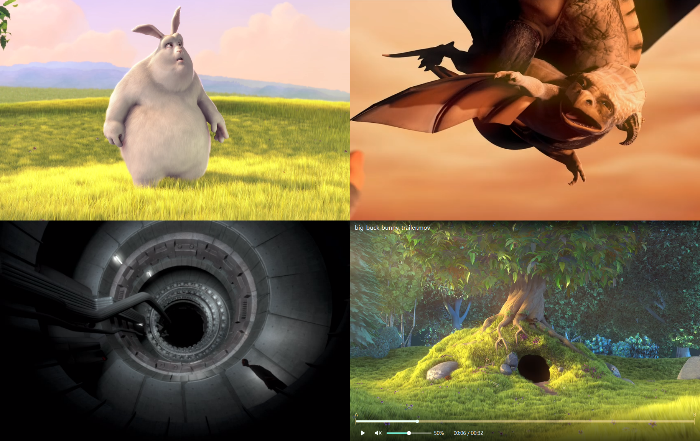

# GridStudio 1.1.0

[简体中文](README.md) | **English**

A freeform video player for **Windows, Linux, and macOS**. Arrange multiple videos on one canvas, resize them, and control their stacking order. When the mouse rests, only the videos remain visible.

[Download the latest release](https://github.com/ssjjrrr/GridStudio/releases/latest) · [1.1.0 release](https://github.com/ssjjrrr/GridStudio/releases/tag/v1.1.0) · [Changelog](CHANGELOG.en.md)



An actual Windows portable build, with four adjacent video panels. [Footage credits](docs/preview-sources.en.md)

## Features

- **Freeform canvas and layers:** move videos freely, resize from any edge or corner, set exact positions and dimensions, and move layers forward or backward.
- **Controls when you need them:** moving the mouse reveals the title, seek bar, play/pause, mute, and volume. They disappear after about two seconds of inactivity and stay visible while dragging a slider.
- **Fit, fill, or stretch:** preserve the full image, fill a panel by cropping its edges, or stretch it. In freeform mode, unused space around a fitted image lets lower videos show through and receive mouse input.
- **Transforms and cloning:** crop, rotate in 90° steps, and flip horizontally or vertically. A clone retains the source, position in the video, transforms, fit mode, volume, speed, loop, and synchronization settings.
- **Loops and synchronization:** loop a whole video or an A/B range; synchronize by time, with time offsets, or by playback percentage. Separate synchronization groups are supported.
- **Workspaces and grids:** save `.gstudio` workspaces with positions, sizes, stacking order, and playback settings. Switch between freeform and grid layouts.
- **English and Chinese:** the interface follows the system language by default, with a saved preference in the context menu. Documentation is available in both languages.

## Download and launch

| System | Download 1.1.0 | Launch |
| --- | --- | --- |
| Windows 10 1809+ / Windows 11, x64 | [Windows x64 ZIP](https://github.com/ssjjrrr/GridStudio/releases/download/v1.1.0/GridStudio-1.1.0-Windows-x64.zip) | Extract everything and run `GridStudio.exe` |
| Ubuntu 22.04+, x86_64 | [Linux x64 TAR.GZ](https://github.com/ssjjrrr/GridStudio/releases/download/v1.1.0/GridStudio-1.1.0-Linux-x64.tar.gz) | Extract and run `GridStudio/GridStudio` |
| macOS 13+, Apple Silicon | [macOS arm64 ZIP](https://github.com/ssjjrrr/GridStudio/releases/download/v1.1.0/GridStudio-1.1.0-macOS-arm64.zip) | Extract, drag `GridStudio.app` to Applications, and open it |
| macOS 13+, Intel | [macOS x64 ZIP](https://github.com/ssjjrrr/GridStudio/releases/download/v1.1.0/GridStudio-1.1.0-macOS-x64.zip) | Extract, drag `GridStudio.app` to Applications, and open it |

[Source ZIP](https://github.com/ssjjrrr/GridStudio/releases/download/v1.1.0/GridStudio-1.1.0-source.zip) · [SHA-256 checksums](https://github.com/ssjjrrr/GridStudio/releases/download/v1.1.0/GridStudio-1.1.0-SHA256SUMS.txt) · [Release validation](docs/validation-1.1.0.md)

Packages include Python and Qt; you do not need to install Python or VLC. On Windows and Linux, keep the entire extracted directory, including `_internal`, `licenses`, and `demo`. On macOS, keep the complete `.app`.

Linux needs a graphical desktop and Qt's system graphics/audio dependencies. Ubuntu 22.04 x64 is the supported baseline; other distributions have not all been tested. Run the included `install-desktop-entry.sh` to add a launcher for your user account. See the [complete guide](README.en.txt) for dependencies and troubleshooting.

The macOS builds use ad-hoc signing and **are not Developer ID signed or notarized by Apple**. If macOS reports an unidentified developer or missing notarization, confirm the download source and follow [Apple's instructions](https://support.apple.com/102445): use **System Settings → Privacy & Security → Open Anyway**.

## Getting started

1. Drop videos onto the window to start playback. Audio is muted by default.
2. Press **Tab** to edit. Drag inside a video to move it, or drag an edge or corner to resize it. Hold **Shift** to preserve the panel's current aspect ratio.
3. Right-click **Layers** to change the stacking order or select a covered panel.
4. Press **Tab** or **Esc** to return to clean playback. **F11** toggles fullscreen.
5. Right-click **Workspace → Save** to save the arrangement and playback settings.

Right-click **Language / 语言** to select English, Simplified Chinese, or the system default. No permanent toolbar is added. You can also launch with `--language en` or `--language zh_CN`.

Open an included `demo/` workspace through **Workspace → Open**. On Windows/Linux, examples are in the application directory; on macOS, they are in `GridStudio.app/Contents/Resources/demo/` (right-click the app in Finder and choose **Show Package Contents**). Workspaces reference video paths and do not embed videos; keep the referenced files when moving a workspace.

Black pixels encoded in a video remain opaque; cropping can remove baked-in black bars. Grid mode and single-video focus retain normal letterboxing. See [README.en.txt](README.en.txt) for the full guide.

## Keyboard shortcuts

On macOS, use **⌘ Command** instead of Ctrl below. Some keyboards require Fn+F11.

| Action | Shortcut |
| --- | --- |
| Edit canvas / return to clean playback | Tab |
| Fullscreen | F11 |
| Add videos / open workspace / save workspace | Ctrl+O / Ctrl+Shift+O / Ctrl+S |
| Clone / close current panel | Ctrl+D / Ctrl+W |
| Move one layer forward / backward | Ctrl+] / Ctrl+[ |
| Bring to front / send to back | Ctrl+Shift+] / Ctrl+Shift+[ |
| Move by one pixel while editing | Shift+arrow key |
| Play/pause; mute | Space; M |
| Toggle looping; set A / B point | L; [ / ] |
| Synchronize all videos to the current panel | Ctrl+G |
| Seek back / forward five seconds | ← / → |
| Rotate; crop | R; C |
| Focus / return to layout | F or double-click |

## Run from source

Use Python 3.12.14. The runtime dependency is pinned to `PySide6==6.10.2`. Run these commands in the project directory.

Windows PowerShell:

```powershell
python -m venv .venv
.\.venv\Scripts\python.exe -m pip install -r requirements.txt
.\.venv\Scripts\python.exe run.py
```

Linux / macOS terminal:

```sh
python3 -m venv .venv
.venv/bin/python -m pip install -r requirements.txt
.venv/bin/python run.py
```

Pass a video or `.gstudio` path as an argument, or add `--edit` to open in edit mode. Use `--language en` / `--language zh_CN` to select the interface language.

## Build and verify

Build natively on the target platform: run `./build.ps1` on Windows or `./build.sh` on Linux/macOS. With development dependencies installed, you can use `python scripts/build.py` directly. Windows output is not converted into Linux or macOS applications.

Install `requirements-dev.txt`, set `GRIDSTUDIO_LANGUAGE=zh_CN` for the test process, then run `python -m pytest tests -q -o faulthandler_timeout=30`. See the [development guide](docs/development.en.md) for platform dependencies, the two real-media hover tests, native builds, and archive verification.

[CI](.github/workflows/ci.yml) tests, builds, and verifies final archives separately for Windows x64, Linux x64, and macOS Apple Silicon and Intel. Consult [GitHub Actions](https://github.com/ssjjrrr/GridStudio/actions) and the [release validation record](docs/validation-1.1.0.md) for actual results.

## Performance and compatibility

Each video, including clones, has its own decoder. Up to 64 panels are allowed. Playback depends on the codecs, resolution, frame rate, hardware, and concurrent videos; synchronization does not provide hardware-level frame locking. Qt Multimedia uses FFmpeg, so format compatibility differs from VLC/GridPlayer. Cropping, rotation, and flipping only affect the display and do not modify the files.

Existing optimizations include incremental layer updates, an on-demand playback control timer, reused UI state, and partial repainting. In a Windows benchmark before the first release, the median of three runs for 20 clone/delete operations with 16 synthetic layers fell from 5132 ms to 498 ms. This measures UI work in that scenario, **not decoding FPS, real multi-stream 4K capacity, or a new measurement for this cross-platform release**. See the [performance audit](docs/performance-audit.en.md) and [benchmark guide](benchmarks/README.en.txt).

## Project and licenses

Independently implemented with Python, PySide6, and Qt Multimedia. [GridPlayer](https://github.com/vzhd1701/gridplayer) inspired the multi-video workflow; its source code is not included.

- [Development, tests, and builds](docs/development.en.md) · [简体中文](docs/development.md)
- [Performance audit](docs/performance-audit.en.md) · [简体中文](docs/performance-audit.md)
- [Test media](docs/test-media.en.md) · [简体中文](docs/test-media.md)
- [Preview footage and credits](docs/preview-sources.en.md) · [简体中文](docs/preview-sources.md)
- [Changelog](CHANGELOG.en.md) · [简体中文](CHANGELOG.md)
- Original application code is [MIT licensed](LICENSE). See [English third-party notices](THIRD_PARTY_NOTICES.en.txt) / [中文声明](THIRD_PARTY_NOTICES.txt) and [licenses/](licenses/) for dependencies. Original license texts are unchanged.
